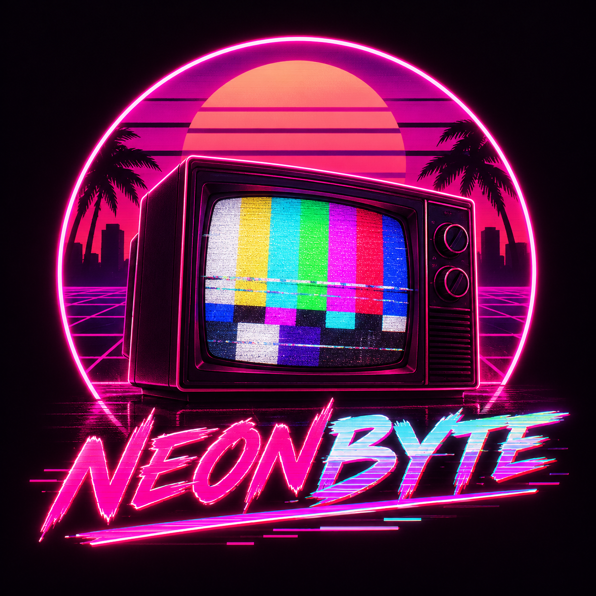

<!-- markdownlint-disable MD033 MD041 -->

  

<h1 align="center">NeonByte</h1>

<strong>A local Spotify and GIF display dashboard with a retro neon look.</strong>

  <a href="docs/installation.md">Get started</a> ·
  <a href="docs/user/spotify.md">Connect Spotify</a> ·
  <a href="docs/user/usage.md">Use the panel</a> ·
  <a href="docs/user/troubleshooting.md">Get help</a>

<!-- markdownlint-enable MD033 MD041 -->

NeonByte is an open-source desktop agent and browser dashboard for a compatible local Wi-Fi display. It reads the current Spotify track, prepares GIFs for a 240 × 240 display, and lets you choose how the display should behave.

## What you can do

- Show Spotify album art, track title, and artist while a track is playing.
- Choose `auto`, `spotify`, or `gif` display modes.
- Convert and preview a GIF locally before choosing whether to send it to a configured device.
- Run the dashboard on your own computer at `http://localhost:8787`.

The display shows track information; it does not play audio or control Spotify playback. The dashboard preview is rendered locally in your browser and is not a live picture from the physical display.

## How it works

- The desktop agent reads playback from the Spotify Web API and serves the local dashboard.
- Your browser talks to that agent on the same computer.
- If you already have a compatible device and firmware, the agent can send playback and prepared animation over your local network after you configure and enable the device connection.

## Requirements

- Windows 11 is the primary desktop setup described in this guide.
- Node.js 22 or 24 and npm. CI exercises these Node.js major versions.
- Git and an Internet connection for setup, Spotify authorization, and playback updates.
- A Spotify account and a Spotify Developer app configured for Development Mode. Spotify currently requires the app owner to have Premium, limits each developer to one Development Mode Client ID, and allows up to five authorized users for an app in this mode. Review Spotify's [current quota rules](https://developer.spotify.com/documentation/web-api/concepts/quota-modes).
- To use a physical display, an already running compatible NeonByte firmware and a local device address and credentials.

The dashboard and agent can run without a device. The repository does not yet establish a general, validated procedure for first-time firmware installation or independent recovery after a failed boot. A maintainer reported that one GIF replacement completed and appeared on the project display on October 29, 2026. That observation does not validate other installation paths, reboot persistence, or long-term operation; see [hardware limits](docs/hardware.md) and [recovery limits](docs/recovery.md).

## Get started

1. [Install the desktop agent on Windows 11](docs/installation.md).
2. [Configure the local agent](docs/user/configuration.md).
3. [Create a Spotify app and connect your account](docs/user/spotify.md).
4. [Choose a mode and prepare a GIF](docs/user/usage.md).
5. If you already have a compatible device, follow the device-connection notes in [configuration](docs/user/configuration.md).

## Display modes

| Mode | What appears |
|---|---|
| `auto` | Spotify while recent playback state confirms a playing track; otherwise the device's GIF scene. |
| `spotify` | Spotify when a track is playing, or a waiting state when there is no current track. |
| `gif` | The GIF scene regardless of Spotify playback. |

The firmware independently expires stale Spotify metadata after 45 seconds. A dashboard preview reflects local agent state and can differ temporarily from the device while the device retains a still-fresh sample.

## Help and details

- [Documentation index](docs/README.md)
- [Troubleshoot a problem](docs/user/troubleshooting.md)
- [Device hardware evidence](docs/hardware.md)
- [Recovery limits](docs/recovery.md)
- [HTTP protocol](docs/protocol.md) and [animation format](docs/animation-format.md)
- [License](LICENSE)
